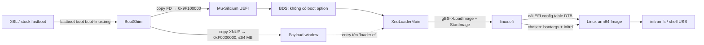

# Kế hoạch: mainline Linux trên picasso (SM7250) qua Mu-Silicium UEFI

Trạng thái: kế hoạch kỹ thuật, chưa thực thi. Mọi số liệu "đã kiểm chứng" dưới đây lấy từ
repository này, vendor device-tree của máy, và source thật của `v7.3-rc7`.

Tham chiếu chính: [lazybrar/avicii-mainline](https://github.com/lazybrar/avicii-mainline) —
mainline Linux cho OnePlus Nord (`avicii`), **cùng SoC SM7250**, base `v7.3-rc7`, 14 patch
theo subsystem.

---

## 0. Mục tiêu và ràng buộc

**Mục tiêu cuối:** một kernel mainline chạy trên picasso, nạp hoàn toàn bằng RAM qua UEFI có
sẵn, đủ để: shell qua USB, mount UFS read-only, màn hình + touch, Wi-Fi. Không cần Android,
không cần flash.

Ràng buộc bất biến (theo `AGENTS.md`):

1. Không ghi UFS: chỉ `fastboot boot` / payload RAM. Không `fastboot flash`, không `dd`.
2. `upstream/` read-only; mọi thay đổi phải thành patch trong `patches/`.
3. Kế hoạch này **không sửa Mu-Silicium / hakios-uefi**. Lý do ở §2 (D1).

**Định nghĩa "done" theo mốc:**

| Mốc | Done khi |
|---|---|
| M0 | `./build.sh linux` sinh `Image` + `sm7250-xiaomi-picasso.dtb` từ `upstream/` + `patches/linux/` |
| M1 | `fastboot boot build/out/boot-linux.img` → thấy `Linux version ...` trên màn hình (ảnh chụp) |
| M2 | Shell qua USB (CDC-ACM/NCM), `nproc` = 8, log đọc được không cần chụp ảnh |
| M3 | UFS enumerate, mount `userdata` **read-only**, checksum khớp |
| M4 | fbcon/DRM lên panel 1080x2400, touch evdev có sự kiện |
| M5 | Wi-Fi WCN3990 associate + DHCP |
| M6 | Audio / charger / sensor / suspend, dọn patch để gửi upstream |

---

## 1. Ground truth (đã kiểm chứng)

### 1.1 Chuỗi boot hiện có — tái dùng nguyên vẹn



Sự thật đọc từ code, không phải suy đoán:

- `prebuilt/BootShim.bin` + `uefi/files/Resources/DTBs/picasso.dtb` (670 468 B, trùng
  `prebuilt/device-tree.dtb`) được đóng gói trong `scripts/build-bootimg.py` thành Android boot
  image v1: `gzip(BootShim + SILICIUM_UEFI.fd + XNUP) + dtb`, chạy bằng
  `fastboot boot build/out/boot-picasso.img` (`README.md`).
- `BootShim.S` (patch trong `hakios-uefi`) copy FD tới `0x9F100000`, rồi nếu 4 byte ngay sau FD
  là magic `XNUP` thì copy tiếp payload tới `0xF0000000`.
- `XnuLoader.h`: `XNU_PAYLOAD_MAX_SIZE = 0x04000000` (64 MB), entry có `Name[16]`, `Size`,
  data pad 16.
- `BootManager.c` (hakios): `PlatformBootManagerUnableToBoot()` → `XnuLoaderMain()`;
  `XnuLoader.c` quét entry tên **`loader.efi`** và `LoadImage/StartImage` nó. Không hardcode nội
  dung — nên ta thay *blob* là xong, không phải sửa firmware.

### 1.2 Linux EFI stub nhận DTB/initrd/cmdline thế nào (v7.3-rc7)

Đọc `drivers/firmware/efi/libstub/{fdt,efi-stub}.c`:

- DTB: `get_fdt()` → `get_efi_config_table(DEVICE_TREE_GUID)`. Tức chỉ cần cài **EFI
  configuration table** trỏ vào DTB mainline của picasso.
- `update_fdt()` copy sang allocation 2 MB, **xoá memreserve map**, ghi `/chosen/bootargs` nếu
  cmdline không rỗng, thêm `linux,uefi-*`, `kaslr-seed`. `/chosen/linux,initrd-*` ta đặt sẵn
  được giữ nguyên.
- cmdline lấy từ `EFI_LOADED_IMAGE_PROTOCOL.LoadOptions` (UTF-16) — launcher truyền được, hoặc
  để trống và dùng `chosen/bootargs` trong DTB.
- initrd: **luôn** là ramdisk trong payload RAM (`initrd.cpio.gz` trong XNUP), launcher ghi
  `/chosen/linux,initrd-start|end`. Không dùng initramfs built-in: rootfs phải thay được mà
  không build lại kernel, giống userland của XNU. (LoadFile2 `LINUX_EFI_INITRD_MEDIA_GUID` là
  lựa chọn thay thế tương đương, không cần thiết.)
- Console sớm: stub gọi `setup_primary_display()` / sysfb từ GOP → `simpledrm`/`simplefb` vẽ
  fbcon lên đúng framebuffer UEFI đang dùng. Không cần driver display để thấy log.
- `Image` là PE32+ (`ImageBase = 0`, không relocation) → `LoadImage/StartImage` hợp lệ; đây là
  đường chuẩn của systemd-boot trên arm64. Cần xác nhận bằng thực nghiệm ở M1, fallback là
  load thủ công theo PE + nhảy entry.

### 1.3 Tài sản tái dùng từ avicii-mainline

14 patch, tổng ~700 KB, base tag `v7.3-rc7` (commit `24a19b9`):

| Patch | Nội dung | Dùng cho picasso? |
|---|---|---|
| 01 bindings | `qcom,ids` SM7250, socinfo, SCM, PDC, cpufreq | **Nguyên** |
| 02 clk | GCC SM7250, RPMh CC, dispcc, gpucc, videocc, camcc | **Nguyên** |
| 03 pinctrl | TLMM SM7250 + UART pinctrl | **Nguyên** |
| 04 interconnect | RPMh NoC SM7250 | **Nguyên** |
| 05 soc-pm | rpmhpd + QPHY | **Nguyên** |
| 06 ufs | QMP UFS PHY SM7250, reset qua pinctrl, **giới hạn 32-bit DMA** | **Nguyên** (quirk rất có thể cần) |
| 07 display | DPU 6.1.0 catalog, mdss/UBWC, panel AMS644VK04 | DPU/mdss **nguyên**, panel **bỏ** |
| 08 iommu | arm-smmu-qcom skip PRR cho GPU SMMU | **Nguyên** |
| 09 power | PM7250B charger/smb5, charge threshold | **Nguyên** (picasso cũng PM7250B smb5) |
| 10 touch | Goodix GT9886 | **Bỏ** (picasso dùng Novatek) |
| 11 remoteproc | MPSS PAS, pd-mapper, IPCC | **Nguyên** (cần cho modem/Wi-Fi) |
| 12 audio | TFA9874 + MI2S | **Bỏ** (amp khác) |
| 13 media | Venus SM7250 | Để M6 |
| 14 dts | `sm7250.dtsi` (3362 dòng) + `sm7250-oneplus-avicii.dts` + `pm7250b.dtsi` | **dtsi nguyên, board dts bỏ**; **phải thay reserved-memory** |

Cảnh báo đã kiểm chứng trong `14-dts.patch`: `reserved-memory` nằm trong `sm7250.dtsi`, và
comment ghi rõ là map của OnePlus (pil_cvp `0x9c700000`, pil_cdsp `0x9cc00000`, adsp
`0x89200000`...). picasso phải override bằng map của Xiaomi — đối chiếu được ngay với
`soc.args` của repo (`smem=0x80900000`, `cmd_db=0x80860000`, `apps_smmu=0x15000000`,
`mpss_mem=0x8c000000`, `ipa=0x1e00000`, `gsi=0x1e04000`, `aoss=0xc300000`) và vendor DT.

### 1.4 Phần cứng picasso, đọc từ vendor DT (giải mã `prebuilt/device-tree.dtb`)

| Thành phần | Chi tiết | Hệ quả cho mainline |
|---|---|---|
| PMIC | PM8150 + PM8150L + PM7250B; `qcom,qpnp-smb5`, `smb1390` | RPMh regulators + PM7250B charger tái dùng patch 09 |
| UFS | `ufshc@1d84000`, UFS 2.1 | patch 06 |
| USB | `dwc3@a600000`, QMP PHY + SS PHY | mainline `dwc3-qcom` + `phy-qcom-qmp`; cần SMMU stream ID |
| Wi-Fi/BT | WCN3990: `qcom,icnss@18800000`, `wlan_fw_mem` `0x8ba00000` | `ath10k_snoc` + SCM PAS, firmware từ máy |
| Panel | `qcom,mdss_dsi_g7a_37_02_0a_dsc_video`: **1080x2400, 120 Hz, DSI video mode, DSC 1.1**, 1 DSI | không có trong mainline; cần panel driver + DSI DSC video |
| Touch | `novatek,NVT-ts-spi`, NT36672C, fw `novatek_nt36672c_g7a_fw01.bin` | driver SPI mới (khác GT9886) |
| Đèn nền | PM8150L WLED | backlight qua WLED, không phải PWM |

Không tìm thấy port mainline công khai nào cho picasso (chỉ có kernel Android 4.19 của Xiaomi
và các bản rebase) → DTS phải viết, nhưng toàn bộ phần SoC đã có sẵn từ avicii.

### 1.5 Tham chiếu downstream: `/home/tritm/droidian` (đã chạy thật trên chính máy này)

Đây là project Droidian/Halium của tác giả, chạy kernel downstream 4.19 và đã verify toàn bộ
phần cứng. Giá trị lớn nhất: **cây kernel downstream có DTS đầy đủ của picasso**, tức nguồn
giá trị chính xác cho DTS mainline — không phải suy luận từ blob DT.

| Bằng chứng downstream | Vị trí | Hệ quả cho kế hoạch |
|---|---|---|
| `picasso-sm7250.dtsi`, `picasso-sm7250.dts`, `xiaomi-sm7250-common.dtsi`, `lito-*.dtsi` | `kernel/arch/arm64/boot/dts/vendor/qcom/` | Nguồn DTS chính: gpio, regulator, ufs, usb, touch, panel, charger, smp2p |
| Panel `dsi-panel-g7a-37-02-0a-dsc-video.dtsi`: 1080x2400, **120 Hz**, DSC slice `540x20`, `slice-per-pkt=2`, 8bpc/8bpp | cùng thư mục | Thông số chính xác cho panel driver M4 (thay vì đọc blob) |
| Panel rails: `vddio = L1C`, `lab/ibb = ab_vreg/ibb_vreg`; TE `tlmm 10`; reset `pm8150l_gpios 3` | `lito-sde-display.dtsi`, `xiaomi-sm7250-common.dtsi` | PM8150L regulator + GPIO là đủ; không cần PMIC riêng cho display |
| Touch: `spi@984000` (SE7), 5 MHz, reset `tlmm 4`, IRQ `tlmm 5` (flag `0x2001`), nạp fw `novatek_nt36672c_g7a_fw0{1,2,3}.bin` theo `tp-vendor/glass-vendor` | `picasso-sm7250.dtsi`, `picasso-sm7250-pinctrl.dtsi` | M4 cần driver có firmware-loading, không chỉ `novatek-nvt-ts` upstream |
| USB: `ssusb@a600000`, `iommus = <&apps_smmu 0xE0>`, DWC3 + QMP PHY | `lito-usb.dtsi`, `picasso-sm7250.dtsi` | Stream ID cho M2 (khớp `soc.args`/XNU) |
| Charger: `pm7250b_charger` + battery-data + PD PHY; không có gauge rời | `picasso-sm7250.dtsi` | Patch 09 tái dùng; **gauge là việc mới** (QGauge của PM7250B, mainline chưa có) |
| Audio: TFA9874 trên **Secondary** MI2S, WCD938x qua SoundWire, downstream dùng techpack + `adspboot.ko` | `picasso-audio-overlay.dtsi`, `docs/09-audio-bt-status.md` | Patch 12 (TFA9874 của avicii) dùng lại được, chỉ đổi MI2S port + I2C/GPIO |
| Wi-Fi: cần `wlan.ko` + chờ container 240 s + `/dev/wlan` ON; fw `adsp.*`, `bdwlan.*`, `bdf_g7a.bin`, `wlanmdsp.mbn` | `docs/08-wifi-bringup-tested.md`, `device/picasso/firmware/firmware-list.txt` | Mainline đi `ath10k_snoc` (không cần container); board file `bdf_g7a.bin` phải đóng gói đúng định dạng ath10k |
| BT: chỉ chạy qua vendor HAL + `bluebinder` (Android), native stack chưa từng chạy | `docs/09-audio-bt-status.md` | Mainline `hci_qca` + UART5 là đường **chưa được chứng minh** — xếp M6, không hứa |
| GPU: downstream dùng kgsl + libhybris; UI 1080x2400@120 Hz qua wlroots HWC | `docs/10-graphics-and-display-acceleration.md` | Mainline dùng `drm/msm` + freedreno/Turnip (avicii đã chứng minh), không dùng kgsl |
| Boot image đã chứng minh: header v2, kernel@`0x8000`, ramdisk@`0x1200000`, tags@`0x100`, dtb@`0x1728000`, **bắt buộc có DTB**; kernel giải nén ~48 MB | `docs/02-boot-image-layout.md`, `scripts/pack_boot.sh` | Dùng đúng tham số này cho lớp ngoài của `boot-linux.img` |
| cmdline downstream: `earlycon=msm_geni_serial,0x4a90000`, **không** `console=` (ttyMSM0 không bind) | `scripts/pack_boot.sh` | M1 thêm earlycon `0x4a90000` để có thêm một kênh log (nếu pad đã được XBL cấu hình) |
| CABC/ACL/Smart DFPS của Xiaomi gây nháy sáng, phải khoá bằng `disp_param` | `docs/hardware-status.md` §1 | Panel driver mainline phải set các thanh ghi này, không chỉ bật DSI |

---

## 2. Quyết định kiến trúc

**D1 — Boot vehicle: launcher UEFI riêng, đóng gói thành entry `loader.efi`.**
Không sửa Mu-Silicium, không flash `boot_a`. `BootManager` đã có sẵn cơ chế
`LoadImage("loader.efi")`; ta chỉ đổi nội dung XNUP. Loại bỏ phương án của avicii
(`flash boot_a` từ recovery) vì vi phạm invariant 1.

**D2 — Kernel base: `v7.3-rc7` + vendor nguyên bộ patch avicii, delta picasso xếp sau.**
Không tự viết lại clock/pinctrl/interconnect — đó là ~500 KB patch đã chạy trên cùng SoC.
Giữ cả `sm7250-oneplus-avicii.dts` trong series (không dùng, không ảnh hưởng build) để
provenance rõ ràng; delta picasso là patch riêng. DTS picasso **không viết tay từ blob**: lấy
giá trị từ cây downstream đã chạy thật (`~/droidian/kernel/.../vendor/qcom/`), đối chiếu
`prebuilt/device-tree.dtb` khi cần.

**D3 — `linux.efi` là loader RAM-resident, không phải bootloader đầy đủ.**
Nhiệm vụ: đọc `Image`/`initrd`/`dtb` từ payload → cài config table DTB → set `chosen` →
`LoadImage/StartImage`. Đồng thời giữ **fastboot listener** như `xnuloader`: `fastboot stage
Image`, `fastboot oem ramdisk` + `stage initrd.cpio.gz`, `fastboot oem run` để nạp lại kernel +
ramdisk mà không phải upload lại UEFI. Tái dùng code fastboot của
`upstream/hakios-xnu-kernel/xnuloader/`. Kernel + initrd luôn nằm trong RAM; không có rootfs
trên UFS, không có initramfs built-in.

**D3b — Vòng lặp thử nghiệm giống XNU:** build → `stage`/`oem run` (không reboot máy tính) →
trong Linux `reboot` để quay lại loader. Trong initramfs có `kexec` (tuỳ chọn) để thay kernel
mà không cần reset firmware. Không ghi UFS ở bất kỳ bước nào.

**D4 — Logging: fbcon trước, USB sau, RAM marker là phương án cuối.**
`simpledrm` cho log trên panel ngay M1; USB CDC-ACM ở M2. Nếu kernel chết trước USB: ghi
marker vào vùng RAM reserved rồi đọc lại bằng `fetch_data.py` (hakios-xnu-kernel/tools) (xnuloader upload) sau khi
quay về fastboot. Không dùng `pstore/blk` vào `logdump` trừ khi được duyệt riêng.

**D5 — Không đụng XNU path.** Patch Linux nằm ở `patches/linux/`, series riêng; `./build.sh all`
và 6 patch XNU giữ nguyên hành vi.

---

## 3. Tích hợp repository

### 3.1 Cây thư mục thêm mới

```text
upstream/linux/                     # clone torvalds/linux @ v7.3-rc7 (read-only, gitignored)
upstream/avicii-mainline/           # clone tham chiếu (read-only, gitignored)
patches/linux/UPSTREAM              # pin: linux v7.3-rc7 + avicii commit
patches/linux/series                # vendor/01..14, rồi picasso/0001..
patches/linux/vendor/               # nguyên bản avicii (GPL-2.0, giữ header)
patches/linux/picasso/0001..N.patch # delta của picasso
patches/xnuloader/                     # patch nhỏ lên xnuloader (thêm nhánh boot Image)
configs/linux/base.config           # arm64 defconfig + EFI/simpledrm/initramfs
configs/linux/picasso.config        # UFS, USB, PMIC, drm/msm, ath10k...
scripts/build-bootimg.py        # XNUP{linux.efi,Image,initrd,dtb} + boot image
scripts/mkinitramfs.sh          # ramdisk: init tĩnh (in máy, tự reboot nếu được yêu cầu)
initramfs/init.c                  # /init của ramdisk
```

### 3.2 Series patch

`patches/linux/series`:

```text
vendor/01-bindings.patch
...                      # 02..13 nguyên bản
vendor/14-dts.patch      # sm7250.dtsi + pm7250b.dtsi (avicii dts đi kèm, không dùng)
picasso/0001-arm64-dts-qcom-sm7250-picasso-reserved-memory.patch
picasso/0002-arm64-dts-qcom-add-sm7250-xiaomi-picasso.patch
picasso/0003-drm-panel-g7a-37-02-0a-dsc-video.patch
picasso/0004-input-novatek-nt36672c.patch
picasso/0005-...                     # chỉ thêm khi có thay đổi driver chung
```

Quy tắc: file trong `drivers/` của repo này **không** dùng cho Linux (đó là driver XNU/Darwin).
Driver Linux chỉ tồn tại dưới dạng patch trong `patches/linux/picasso/`.

`patches/linux/UPSTREAM`:

```yaml
linux:
  repository: https://github.com/torvalds/linux.git
  revision:   24a19b953e2a3d0ea5a8c4951a0ab8f32720c907   # v7.3-rc7
avicii-mainline:
  repository: https://github.com/lazybrar/avicii-mainline.git
  revision:   71944476a1394d0e6faa6ee95fb157a29dce6943
```

### 3.3 `build.sh`

Thêm target (giữ nguyên hành vi cũ):

```bash
./build.sh linux              # Image + sm7250-xiaomi-picasso.dtb → build/out/
./build.sh linux-bootimg      # boot-linux.img (BootShim + FD + XNUP payload)
./build.sh export-linux-patches
```

- `verify_upstream_clean()`: thêm pin cho `upstream/linux` (tag + commit) và kiểm tra
  `git status` sạch; `upstream/avicii-mainline` chỉ cần đúng commit.
- Workspace: `build/linux/` (clone từ `upstream/linux`, apply `patches/linux/series`).
- Kernel build: `make O=build/linux ARCH=arm64 LLVM=1 defconfig` →
  `scripts/kconfig/merge_config.sh` với `configs/linux/*.config` → `olddefconfig` →
  `Image qcom/sm7250-xiaomi-picasso.dtb`.
- Dùng `LLVM=1` (clang có sẵn trên máy) để khớp CI và tránh phụ thuộc GNU toolchain.

### 3.4 Kernel config (khởi điểm)

`configs/linux/base.config`: `CONFIG_EFI=y`, `CONFIG_EFI_STUB=y`, `CONFIG_ARM64_VA_BITS_39=y`,
`CONFIG_INITRAMFS_SOURCE="…/initramfs"`, `CONFIG_DRM=y`, `CONFIG_DRM_SIMPLEDRM=y`,
`CONFIG_SYSFB_SIMPLEFB=y`, `CONFIG_FRAMEBUFFER_CONSOLE=y`, `CONFIG_SERIAL_EARLYCON=y`,
`CONFIG_PSTORE=y` (chưa bật backend), `CONFIG_USB_GADGET=y`, `CONFIG_USB_CONFIGFS=y`,
`CONFIG_USB_CONFIGFS_ACM=y`, `CONFIG_USB_CONFIGFS_NCM=y`.

`configs/linux/picasso.config`: `CONFIG_QCOM_CLK_SM7250`, `CONFIG_PINCTRL_SM7250`,
`CONFIG_QCOM_RPMHPD`, `CONFIG_INTERCONNECT_QCOM_SM7250`, `CONFIG_SCSI_UFS_QCOM`,
`CONFIG_PHY_QCOM_QMP_UFS`, `CONFIG_ARM_SMMU`, `CONFIG_USB_DWC3_QCOM`,
`CONFIG_PHY_QCOM_QMP`, `CONFIG_DRM_MSM`, `CONFIG_DRM_PANEL_*` (mới), `CONFIG_ATH10K_SNOC`,
`CONFIG_QRTR`, `CONFIG_QCOM_Q6V5_PAS`.

Bật/tắt theo mốc, không bật hết ngay: mỗi mốc chỉ thêm subsystem tương ứng để log không nhiễu
và để cô lập lỗi.

---

## 4. Lộ trình

Ước lượng theo người-ngày, giả định máy build sẵn và điện thoại trong tay.

| Mốc | Nội dung | Ước lượng | Exit criteria |
|---|---|---|---|
| P0/M0 | Vendor upstream + series + `build.sh linux` | 1–2 | Build sạch từ `upstream/`; `dtbs_check` chỉ còn diagnostics của binding vendor, không có lỗi phát sinh từ node picasso |
| P1/M1 | `linux.efi` + boot image + kernel "hello" | 2–4 | `Linux version` trên panel; DT parse đúng (`/proc/device-tree` chưa có, nhưng log `OF:` liệt kê node) |
| P2/M2 | initramfs + USB gadget + SMP | 3–6 | Shell USB, 8 CPU, log đọc bằng máy |
| P3/M3 | UFS + PMIC/regulator + cpufreq/thermal | 3–5 | Enumerate UFS, mount `userdata` ro, `nproc`/`cpufreq` ổn định |
| P4/M4 | Display (DPU/DSI/DSC) + touch Novatek | 5–10 | fbcon/DRM lên panel, evdev touch |
| P5/M5 | Wi-Fi WCN3990 (ath10k_snoc + SCM PAS) | 5–10 | Scan + WPA2 + DHCP |
| P6/M6 | Audio, charger, sensor, suspend, upstream | 10+ | Theo nhu cầu |

### P0 — Nền build (không cần máy)

1. Thêm `upstream/linux`, `upstream/avicii-mainline`; viết `patches/linux/UPSTREAM`, copy 14
   patch nguyên bản (`vendor/`), tạo `series`.
2. `build.sh linux`: clone → `git apply` series → defconfig + merge config → build `Image` +
   dtb. Fail sớm nếu bất kỳ patch nào không apply (`git apply --check` trước).
3. `picasso/0001`: override `reserved-memory` trong `sm7250.dtsi` bằng map của Xiaomi (đối
   chiếu vendor DT + `soc.args`), gồm `hyp`, `smem`, `cmd-db`, `adsp`, `mpss`, `wlan_fw`,
   `ipa_fw`, `ipa_gsi`, `cdsp`, `cdsp_sec`, `gpu zap`.
4. `picasso/0002`: `sm7250-xiaomi-picasso.dts` tối thiểu — `model`, `compatible`
   (`xiaomi,picasso`), memory (`0x80000000`, size theo vendor DT), `chosen/bootargs`,
   `aliases`, các regulator `always-on` cho rail boot. Lấy node/giá trị từ
   `~/droidian/kernel/arch/arm64/boot/dts/vendor/qcom/{picasso-sm7250.dtsi,
   xiaomi-sm7250-common.dtsi, lito-usb.dtsi}`; chỉ chuyển những gì mốc hiện tại cần
   (UART, USB, UFS, PMIC), không copy nguyên board dtsi.
5. Bảng đối chiếu DTS (làm một lần, để trong `docs/`): mỗi node mainline ↔ file downstream
   ↔ dòng, cho panel/touch/usb/ufs/charger. Dùng lại khi review từng patch.
6. `make dtbs_check` với bindings mới của avicii; thêm `sm7250-xiaomi-picasso.dtb` vào
   `arch/arm64/boot/dts/qcom/Makefile`.

**Không làm ở P0:** display, touch, wifi, audio.

### P1 — Boot vehicle

1. `patches/xnuloader/0001-xnuloader-boot-mainline-linux-image.patch`: thêm nhánh Linux vào
   `xnuloader` (freestanding UEFI app, clang-15 + lld-link):
   - parse payload: entry `Image`, `initrd`, `dtb`;
   - cài DTB vào EFI configuration table (`DEVICE_TREE_GUID`), ramdisk đọc từ
     `/chosen/linux,initrd-*` do packer ghi sẵn;
   - `gBS->LoadImage` + `StartImage` trên `Image`;
   - in tiến trình ra GOP ("== LINUX Image ... ==") để phân biệt loader chạy vs kernel chết;
   - giữ nguyên toàn bộ fastboot listener sẵn có (`stage`, `oem run`) — nhờ vậy vòng iterate
     dùng lại đúng giao thức của XNU, không phải viết USB stack mới.
   Build: `./build.sh loader` → `build/out/linux.efi` (cần `IDENTITY_H` cho upstream).
2. `scripts/build-bootimg.py`: `gzip(BootShim + FD + XNUP{loader.efi=linux.efi, Image,
   initrd.cpio.gz, picasso.dtb}) + UEFI dtb` (dtb section vẫn là `picasso.dtb` của UEFI, không
   phải DTB mainline). Initrd là cpio.gz với init tĩnh, hiện ~0.3 MiB, phải < 12 MiB để vừa
   ngân sách 64 MiB.
3. cmdline M1: `console=tty0 earlycon=msm_geni_serial,0x4a90000 loglevel=8 ignore_loglevel
   printk.time=1 panic=10 clk_ignore_unused pd_ignore_unused regulator_ignore_unused`.
   Downstream chứng minh `earlycon=msm_geni_serial,0x4a90000` chạy được trên máy này và
   `console=ttyMSM0` **không bao giờ bind** — nên `tty0` (simpledrm) là console chính, earlycon
   chỉ là kênh phụ nếu pad debug đã được XBL cấu hình.
4. Lớp ngoài của boot image: dùng đúng tham số đã chứng minh của downstream
   (`docs/02-boot-image-layout.md`): header v2, `kernel_offset=0x8000`, `tags_offset=0x100`,
   DTB **bắt buộc** ở `dtb_offset`; kernel giải nén ~48 MB nên ramdisk offset phải > `0x1000000`.
   Trong kế hoạch này kernel nằm trong XNUP nên chỉ ảnh hưởng vị trí blob gzip.
5. Chạy: `fastboot boot build/out/boot-linux.img`; chụp panel. Nếu `LoadImage` fail → thử
   load thủ công theo PE (đọc header, `AllocateAddress` tại `ImageBase`, copy section, gọi
   entry với `x0 = handle`, `x1 = system table`).

### Vòng lặp thử nghiệm (ramdisk, giống XNU)

```sh
# một lần: từ stock bootloader
fastboot boot build/out/boot-linux.img

# mỗi lần sửa kernel/initrd/dtb: repack rồi stage cả payload, không upload lại UEFI
./scripts/build-bootimg.py ... --payload-out build/out/payload-linux.bin
fastboot stage build/out/payload-linux.bin
fastboot oem run
```

Payload staged là một XNUP đầy đủ (`linux.efi` + `Image` + `initrd` + `dtb`) nên chỉ một lần
`stage` cho mỗi vòng. Trong Linux, `reboot` (hoặc `auto_reboot=<giây>` trong cmdline của init)
đưa máy về loader để stage tiếp — cùng mô hình `xnuloader`/XNU userland. Nếu kernel panic trước
khi kịp stage, quay lại `fastboot boot` từ bootloader (RAM-only). Khi có USB network (M2), thêm
`kexec` để thay kernel ngay trong Linux mà không cần reset firmware.

### P2 — initramfs + USB

1. `scripts/mkinitramfs.sh`: busybox + `init` tối giản in `uname -a`, `nproc`, mount
   proc/sys/dev, bật gadget NCM+ACM giống `initramfs/init` của avicii, telnet/shell; thêm
   `reboot` (đưa về loader) và, khi có USB network, `kexec` để thay kernel không cần reset.
2. DTS: `usb@a600000` (dwc3), QMP PHY, SS PHY, `iommus` (stream ID từ vendor DT), `rpmhpd`,
   interconnect. Debug USB bằng cách so `dmesg` với log XNU đã có (`hakios.picasso_usb.c`).
3. SMP: kiểm tra PSCI, `cpu-map`, `cluster idle` (avicii đã fix 2 commit về cái này).
4. Watchdog: xác nhận tuỳ chọn `watchdog.handle_boot_enabled=0` có trong `v7.3-rc7`; nếu
   không, patch nhỏ để kernel không reset khi treo (mất log).

### P3 — Storage + power

1. UFS: `ufshc@1d84000` + `ufsphy`, giữ quirk 32-bit DMA của avicii nếu cần; thêm
   `qcom,ice`? (không cần nếu không mã hoá).
2. PMIC: RPMh regulators cho `vdd*` của UFS/PHY/USB; `qpnp-rtc`, `pm8150-pon` (reboot mode).
3. `cpufreq` (`qcom-cpufreq-hw`) + TSENS thermal zones (map `thermal_tm0/tm1` trong `soc.args`).
4. Root: ext4 trên `userdata`, mount `ro` trước; chỉ chuyển `rw` khi có backup và có lý do.

### P4 — Display + touch

1. `drm/msm` + DPU 6.1.0 (patch 07) + DSI; panel driver mới cho `g7a_37_02_0a`, chép thông số
   từ `dsi-panel-g7a-37-02-0a-dsc-video.dtsi`: 1080x2400, 120 Hz (khai báo **cả** timing 60 Hz
   như downstream), video mode, DSC 1.1 (`slice-width 540`, `slice-height 20`, `slice-per-pkt 2`,
   8bpc/8bpp), TE `tlmm 10`, reset `pm8150l_gpios 3`, `vddio = L1C`, `lab/ibb = ab_vreg/ibb_vreg`.
2. Rủi ro: mainline DSI có thể chưa hỗ trợ DSC ở video mode → phải thêm plumbing. Trong lúc
   chờ, giữ `simpledrm` để vẫn có console.
3. Panel driver mainline phải khoá CABC/ACL/Smart DFPS bằng `disp_param` (downstream phải làm
   mới hết nháy sáng) — đưa vào patch riêng, có boot-arg để tắt khi debug.
4. Touch: driver SPI Novatek NT36672C trên `spi@984000` (SE7), 5 MHz, reset `tlmm 4`, IRQ
   `tlmm 5` (flag `0x2001`), `reset-tddi = pm8150l_gpios 3`. Khác `novatek-nvt-ts` upstream:
   phải nạp `novatek_nt36672c_g7a_fw0{1,2,3}.bin` chọn theo `tp-vendor`/`glass-vendor`, nên
   cần driver riêng (tham chiếu `drivers/input/hakios.novatek.c` của XNU và driver downstream).
5. Backlight: PM8150L WLED (`/sys/class/backlight/backlight` downstream), không phải PWM;
   giữ mức sáng mặc định khi boot như `backlight-boot.service` của downstream.

### P5 — Wi-Fi

- `ath10k_snoc` + `qcom,wcn3990-wifi` + reserved `wlan_fw_mem`. Firmware lấy từ máy, đúng bộ
  downstream đã liệt kê trong `device/picasso/firmware/firmware-list.txt`:
  `wlanmdsp.mbn`, `bdwlan.*`, board data `bdf_g7a.bin` / `bdf_g7ac.bin` (thêm `adsp.*` khi làm
  audio). Đặt dưới `qcom/sm7250/xiaomi/picasso/`.
- Khác biệt lớn so với downstream: đường downstream (`wlan.ko` + QMI icnss + container 240 s +
  `/dev/wlan ON`) **không dùng được** cho mainline; `ath10k_snoc` tự load firmware qua SCM PAS
  và cần board data đúng định dạng ath10k → phải thử `bdwlan.elf`/`board-2.bin` nếu `bdf_g7a.bin`
  không được nhận.
- Cần `qcom_scm` PAS hoạt động (patch 01 SCM + patch 11 MPSS/IPCC). Nếu PAS bị TZ từ chối
  (như CDSP/Venus của avicii), ghi nhận `-22` và để M6.

### P6 — Audio, BT, gauge, sensor, GPU userland

- **Audio:** amp đúng là TFA9874 (giống avicii) nhưng nối **Secondary** MI2S; codec WCD938x qua
  SoundWire. Tái dùng patch 12, đổi MI2S port/I2C/GPIO theo `picasso-audio-overlay.dtsi`;
  đường mainline là `q6apm/q6prm` + WCD938x, **không** dùng techpack/`adspboot.ko` downstream.
- **BT:** downstream chỉ chạy qua vendor HAL + `bluebinder`, native stack chưa từng chạy. Mainline
  đi `hci_qca` + UART5 (`bt_wcn3990` node, `qca,bt-sw-ctrl-gpio`) với `crbtfw32.tlv`/`crnv32.bin`
  trong `bt_firmware`. Coi đây là hạng mục **chưa có tiền lệ**, đừng đưa vào milestone bắt buộc.
- **Gauge:** downstream dùng battery-data/QGauge của PM7250B; mainline chưa có driver tương ứng
  (avicii dùng bq27541 rời nên không tái dùng được). Cần driver mới hoặc chỉ hiển thị áp/current
  qua ADC trước.
- **Sensor:** SSC qua ADSP + FastRPC (avicii đã làm); downstream dùng `sensorfwd` nên không tái dùng.
- **GPU userland:** mainline dùng freedreno/Turnip như avicii; kgsl/libhybris của downstream
  không áp dụng.

---

## 5. Rủi ro

| Rủi ro | Khả năng | Giảm thiểu |
|---|---|---|
| BDS boot nhầm option UFS thay vì payload | Thấp | XNU đã chạy đúng đường này; nếu sai, xoá BootOrder/giữ phím Volume-Up |
| `LoadImage` từ chối `Image` | Thấp–TB | Thử trước ở M1; fallback load PE thủ công + nhảy entry |
| `sm7250.dtsi` mang reserved-memory của OnePlus | **Chắc chắn** | `picasso/0001` override toàn bộ; đối chiếu vendor DT + `soc.args` |
| Panel DSC video mode chưa được mainline DSI hỗ trợ | TB–cao | `simpledrm` cho M1–M3; P4 mới làm; tách patch DSI DSC để dễ revert |
| UFS treo do thiếu regulator / 32-bit DMA | TB | Giữ rail always-on từ XBL (avicii làm vậy), giữ quirk DMA |
| Không có serial, kernel chết im lặng | Cao | fbcon + USB ACM + RAM marker đọc bằng `fetch_data.py` (hakios-xnu-kernel/tools) |
| Watchdog reset trước khi kịp đọc log | TB | Tắt watchdog trong kernel khi bring-up |
| Firmware (Wi-Fi/ADSP/GPU zap) thiếu hoặc sai path | TB | `pull-firmware.sh` sẵn có; đặt dưới `/lib/firmware/qcom/sm7250/xiaomi/picasso/` |
| Board data Wi-Fi `bdf_g7a.bin` không đúng định dạng ath10k | TB | Thử `bdwlan.elf`/`board-2.bin`; nguồn `bdwlan.*` lấy từ vendor |
| BT native (`hci_qca`) chưa từng chạy trên máy này | Cao | Không đưa vào milestone; hạ xuống "thử nghiệm" ở M6 |
| Touch cần nạp firmware theo biến thể panel (`fw01/02/03`) | TB | Viết driver riêng, không dựa `novatek-nvt-ts`; test cả 3 biến thể |
| Gauge PM7250B không có driver mainline (downstream dùng QGauge) | TB | Hiển thị áp/current qua ADC trước, driver gauge sau |
| `earlycon@0x4a90000` không có pad ra ngoài | Thấp | Chỉ là kênh phụ; console chính vẫn là `tty0` + USB |
| Image 51 MB (đo trên bản M0) làm payload 64 MiB chật | TB | initramfs < ~12 MiB; hoặc `CONFIG_EFI_ZBOOT` (Image.gz PE) hay cắt config |
| Patch avicii trôi khi upstream đổi | TB | Pin commit; `git apply --check` trong CI |

---

## 6. Việc làm ngay (theo thứ tự)

0. Trích bảng DTS từ `/home/tritm/droidian/kernel/arch/arm64/boot/dts/vendor/qcom/` (panel,
   touch, usb, ufs, charger, regulator) và đối chiếu `prebuilt/device-tree.dtb`; lưu vào
   `docs/dts-crosswalk.md` trước khi viết patch DTS đầu tiên.
1. Thêm `upstream/linux` (`v7.3-rc7`, commit `24a19b9`) + `upstream/avicii-mainline`; pin vào
   `patches/linux/UPSTREAM`.
2. Copy 14 patch vào `patches/linux/vendor/`, tạo `series`, kiểm tra apply sạch.
3. Viết `build.sh linux` + `configs/linux/{base,picasso}.config`; build `Image` + dtb.
4. Viết `picasso/0001` (reserved-memory) và `picasso/0002` (DTS tối thiểu); `dtbs_check`.
5. Viết `uefi/linuxloader/` + `scripts/build-bootimg.py`.
6. Boot M1, chụp panel, lưu ảnh + log vào `note.md`.
7. Viết initramfs USB, đạt M2, rồi mới mở UFS.
8. Sau mỗi mốc: `./build.sh export-linux-patches`, cập nhật `note.md` và `device.conf`
   (thêm các dòng `status linux-*`), commit.

---

## 7. Ghi chú vận hành

- Không dùng lại driver XNU trong `drivers/` cho Linux; chỉ dùng làm tham chiếu chuỗi
  init (đặc biệt Novatek, UFS, USB).
- Mọi thay đổi kernel phải đi qua `patches/linux/picasso/`; không sửa trực tiếp
  `build/linux/` rồi quên export.
- Mỗi lần đổi DTB: kiểm tra `dtc -I dtb -O dts` trên `build/out/*.dtb` để chắc override đã ăn.
- Log mang tính quyết định: `dmesg | head -200` từ USB console, không dựa vào ảnh chụp khi đã
  có USB.
- `~/droidian` là oracle phần cứng: giá trị chưa rõ → tìm trong
  `kernel/arch/arm64/boot/dts/vendor/qcom/*.dtsi` trước khi đoán; `~/droidian/docs/` ghi lại
  các hard rule đã trả giá (boot layout, Wi-Fi attach race, CABC/DFPS, touch fw).
- Quy trình downstream (`fastboot flash boot`, container, `wlan.ko`) **không** áp dụng ở đây:
  mainline chỉ RAM-boot và không ghi UFS.
